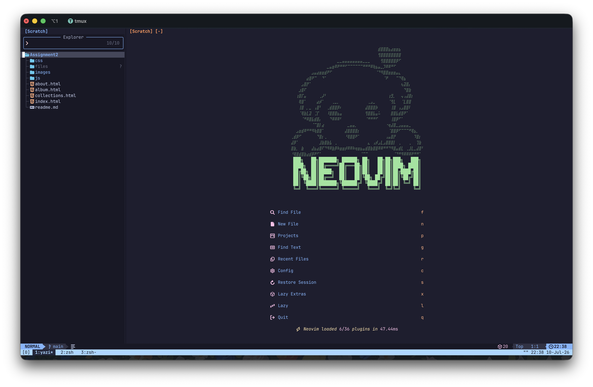
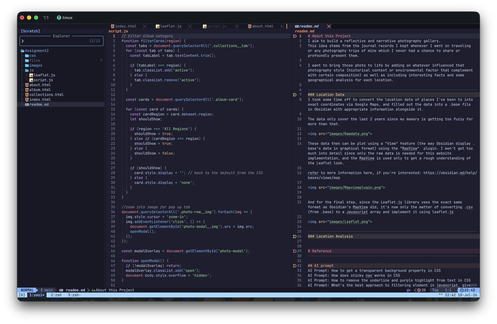
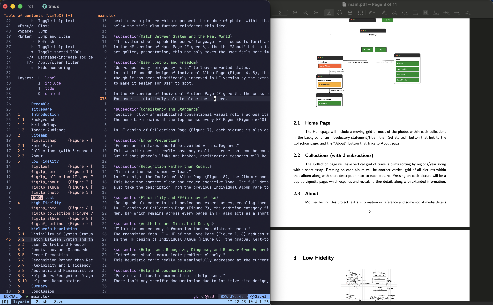

# Custom Configs
## keymaps.lua
- allow jumping to Global mark inside opened window instead of replacing current window
- enable second buffer clipboard (maps standard MacOS Cmd+c to copy text directly from system's clipboard)
  - this must be paired with terminal emulator that can fire keystrokes (mine is iTerm2)

___
# Custom Plugins
## snacks-mark
- fzf marks within that buffer and jump to it

## snacks-jump
(this is an addition to `<leader>space` or `<leader>,` which fzf unopened buffer and opened buffer respectively but doesn't jump to it)
- fzf opened buffer (that's inside a specific window) and jump to it
  - if the selected opened buffer doesn't occupy a specific window, then it replaces the current window
  - the list always show the last visited window on top while filter out the window it's currently only when firing the command

## snacks-diff
- space + g + F
	- anchor current file and diff against another file

## snacks-commit-diff
- space + g + m
	- commit diff file in specific commit against current local version
		- pressed: can be use to view side by side diff current local against that commit commit

supposed to work in parallel with 
- space + g + f (native)
	- commit diff file in specific commit against its previous commit
		- pressed: can use for checking out
		- can also be used for applying individual patch 
___
# Colorscheme
This is a custom catppuccin-mocha theme with the current line number's color of tokyonight's
and link the winbar as well as indent line to that same color

___
# Preview

## Home Page

## Default use case

## LaTeX use case

___
# This config relies heavily on 💤 LazyVim

A starter template for [LazyVim](https://github.com/LazyVim/LazyVim).
Refer to the [documentation](https://lazyvim.github.io/installation) to get started.

